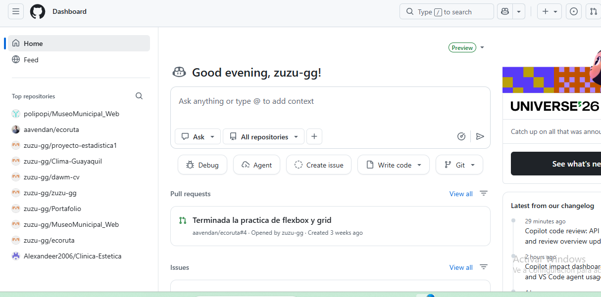

# ¡Hola! Soy zuzu-gg 👋

Me gusta el desarrollo web y crear páginas que sean fáciles de usar, atractivas y funcionales. Disfruto aprender cosas nuevas y poner en práctica mis conocimientos para crear proyectos.

---

##  Sobre mí

- 💻 Me interesa el desarrollo web Frontend y el diseño de páginas web.
- 🎓 Actualmente estudio la carrera de Ciencia de Datos e Inteligencia Artificial y sigo aprendiendo y mejorando mis habilidades en programación, Git y GitHub.
- 🎯 Me gustaría seguir desarrollando proyectos que me permitan aprender y poner en práctica nuevas ideas.
- 📬 Siempre quiero colaborar y aprender junto a otras personas en nuevos proyectos.

---

## Habilidades y Tecnologías 

Esta es una tabla que contiene los badges de las herramientas y tecnologías que conozco, organizados por categorías.

| Categoría | Tecnologías y Herramientas |
| :--- | :--- |
| **Lenguajes y Desarrollo Web** |     |
| **Control de Versiones** |   |
| **Herramientas** |    |

---

## 🏛️ Proyecto Destacado

### Sitio Web Oficial - Museo Municipal

- **Descripción:** Sitio web creado para dar a conocer el Museo Municipal y permitir que las personas encuentren fácilmente información sobre su historia, actividades, exposiciones y horarios.
- **Tecnologías:** HTML5, CSS3, SCSS y JavaScript.
- **Funcionalidades:** Cuenta con secciones sobre la historia del museo, eventos, galería de fotos, opiniones del público y ubicación.
- **Enlaces:**
  - [Ver repositorio en GitHub](https://github.com/polipopi/MuseoMunicipal_Web)
  - [Visitar sitio web](https://polipopi.github.io/MuseoMunicipal_Web/)

---

## 📈 Experiencia y Actividad en GitHub

A través de mis proyectos y trabajos de la universidad, he tenido la oportunidad de utilizar Git y GitHub para organizar mi código, guardar cambios y trabajar en equipo. He participado en proyectos de desarrollo web, análisis de datos y bases de datos.

### 🗂️ Repositorios y Proyectos Destacados en mi Historial (mostrados en la siguiente imagen)

- **Desarrollo Web Frontend (DAWM):**
  - `MuseoMunicipal_Web`: Sitio web del Museo Municipal desarrollado con **HTML5, CSS3, JavaScript y SCSS**.
  - `Clima-Guayaquil`: Aplicación web para consultar el clima.
  - `dawm-cv` y laboratorios prácticos: Ejercicios y prácticas de desarrollo web utilizando **Flexbox, CSS Grid y JSON**.
  - `ecoruta`: Proyecto del profesor en el que colaboré realizando tareas, compartiendo cambios y enviando *Pull Requests*.

- **Análisis de Datos y Estadística:**
  - `proyecto-estadistica1`: Proyecto realizado en **R** para trabajar con datos estadísticos y compartir los resultados con mi equipo.

- **Bases de Datos y Proyectos Colaborativos:**
  - `Clinica-Estetica`: Participación en el desarrollo de la parte de base de datos utilizando **SQL**.

- **Desarrollo Web Frontend (DAWM):**
  - `MuseoMunicipal_Web`: Sitio web del Museo Municipal desarrollado con **HTML5, CSS3, JavaScript y SCSS**.
  - `Clima-Guayaquil`: Aplicación web para consultar el clima.
  - `dawm-cv` y laboratorios prácticos: Ejercicios y prácticas de desarrollo web utilizando **Flexbox, CSS Grid y JSON**.
  - `ecoruta`: Proyecto del profesor en el que colaboré realizando tareas, compartiendo cambios y enviando *Pull Requests*.

### Explicación de las herramientas utilizadas

Durante el curso de Desarrollo de Aplicaciones Web y Móviles de mi carrera de Ciencia de Datos e Inteligencia Artificial he aprendido a utilizar diferentes tecnologías y herramientas para desarrollar páginas web y aplicaciones:

- **HTML5:** Lo utilicé para organizar el contenido de las páginas web mediante elementos como títulos, párrafos, imágenes, enlaces y secciones.
- **CSS3:** Me permitió dar estilo a las páginas, cambiar colores, tamaños, fuentes y organizar los elementos. También aprendí a utilizar selectores y diferentes unidades de medida.
- **Flexbox y CSS Grid:** Los utilicé para organizar los elementos de las páginas y crear diseños que se adapten a diferentes tamaños de pantalla.
- **SCSS:** Lo utilicé para trabajar y organizar los estilos de forma más ordenada en el proyecto del Museo Municipal.
- **JavaScript:** Lo aprendí para agregar interactividad a las páginas, trabajar con elementos del HTML mediante el DOM y responder a eventos como clics o entradas de texto.
- **JSON:** Lo utilicé para trabajar con información organizada en pares de claves y valores, facilitando el manejo de datos en los ejercicios del curso.
- **TypeScript:** Lo trabajé en la guía TubeTrack para crear estructuras de datos con tipos definidos, organizar el código en módulos y desarrollar funciones para filtrar canciones.
- **APIs:** Aprendí cómo permiten que una aplicación se comunique con otros servicios y obtenga información, como los datos que se pueden consultar en una aplicación del clima.
- **Git y GitHub:** Los utilicé para guardar los cambios del código, llevar un historial de trabajo y colaborar con otras personas mediante repositorios y *Pull Requests*.
- **Vite:** Lo utilicé como herramienta para preparar y ejecutar proyectos de desarrollo web, como en los ejercicios con TypeScript.
- **Visual Studio Code:** Es el editor que utilicé para escribir, organizar y modificar el código de mis proyectos.
- **GitHub Pages:** Lo utilicé para publicar el sitio web del Museo Municipal y permitir que otras personas puedan visitarlo desde internet.
- 📚 **Actualmente:** Sigo organizando, mejorando la presentación de mis proyectos en GitHub, practicando programación y explorando nuevas herramientas para mejorar mis habilidades en desarrollo web y análisis de datos.

---

## Contacto

- **Correo Académico:** `zutorres@espol.edu.ec`
- **GitHub:** [zuzu-gg](https://github.com/zuzu-gg)
